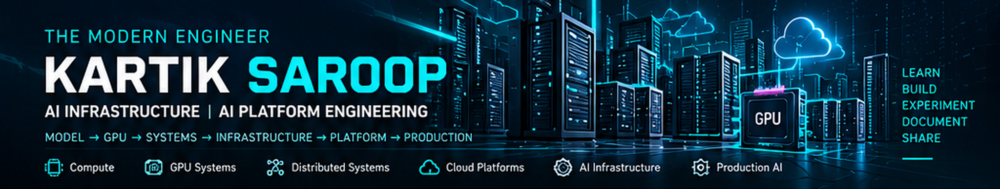

 

---

## 🔹 About

I'm learning to engineer the **compute, systems, infrastructure, and platforms** that support modern AI workloads. I document that journey through **technical notes, practical labs, experiments, and projects**—and build resources that others can learn from.

---

## ⚡ Featured Engineering Work

  Selected implementations, experiments, and technical explorations — from AI models to the infrastructure that supports them.

<table>
  <tr>
    <td width="25%" align="center" valign="top">
      
        
      <strong>GPU Architecture &amp; Memory</strong>
        
      Exploring GPU compute, memory hierarchy, and the systems foundations of AI workloads.
        
      
    </td>
    <td width="25%" align="center" valign="top">
      
        
      <strong>LangChain Prompt Workflows</strong>
        
      Hands-on exploration of prompt templates, model integration, and LLM application workflows.
        
      
    </td>
    <td width="25%" align="center" valign="top">
      
        
      <strong>AWS Managed AI Services</strong>
        
      Investigating managed AI services, cloud capabilities, and deployment-oriented workflows on AWS.
        
      
    </td>
    <td width="25%" align="center" valign="top">
      
        
      <strong>AI Study Assistant</strong>
        
      Exploring AI agent fundamentals through a study-assistant workflow and practical application concepts.
        
      
    </td>
  </tr>
</table>

  Engineering in progress • Documented through code, experiments, and technical notes

---

## 🧪 Hands-on Learning Labs

**`LEARN → PRACTICE → EXPERIMENT → BUILD → EXPLAIN`**

Beginner-friendly, chronological learning paths covering concepts, hands-on labs, troubleshooting, projects, and relevant certification objectives. **All four labs below are planned**; repository links will be activated once the repositories are published.

<table>
<tr>
<td width="25%" align="center" valign="top">
 
  <b>Linux Learning Lab</b> Systems & Administration
  Shell, permissions, processes, services, networking, and troubleshooting.
  
  <code>linux-learning-lab</code>  
</td>
<td width="25%" align="center" valign="top">
 
  <b>Docker Learning Lab</b> Containers & Deployment
  Images, Dockerfiles, volumes, networks, Compose, and containerized projects.
  
  <code>docker-learning-lab</code>  
</td>
<td width="25%" align="center" valign="top">
 
  <b>LangChain Learning Lab</b> LLM Applications
  Models, prompts, structured output, retrieval, tools, agents, and projects.
  
  <code>langchain-learning-lab</code>  
</td>
<td width="25%" align="center" valign="top">
 
  <b>Kubernetes Learning Lab</b> Orchestration & Platforms
  Pods, services, scheduling, storage, networking, RBAC, and operations.
  
  <code>kubernetes-learning-lab</code>  
</td>
</tr>
</table>

<b>📚 What every learning lab will contain</b>

- **Start Here:** prerequisites and a topic-wise learning roadmap
- **Theory:** concepts, explanations, and diagrams
- **Practice:** commands, code, and guided exercises
- **Experiments:** observations, measurements, and reproducible steps
- **Projects:** increasingly complete practical builds
- **Troubleshooting:** errors, debugging, and lessons learned
- **Certification preparation:** mapping to official exam objectives where relevant

---

## 🧩 Explore the Engineering Ecosystem

Instead of repeating the Featured Work cards, this is a **navigation hub** for the complete set of domain-focused repositories.

| Track | Repository | What you'll explore |
|:--|:--|:--|
| ⚡ Infrastructure | **[InfraNerve](https://github.com/themodernengineer-tech/InfraNerve)** | CPU/GPU architecture, CUDA, systems, distributed infrastructure |
| ☁️ Cloud | **[CloudAtlas](https://github.com/themodernengineer-tech/CloudAtlas)** | AWS, compute, networking, storage, cloud architecture |
| 📐 Machine Learning | **[GradientSpace](https://github.com/themodernengineer-tech/GradientSpace)** | Algorithms, optimization, evaluation |
| 🧠 Deep Learning | **[NeuroVerse](https://github.com/themodernengineer-tech/NeuroVerse)** | Neural networks and deep learning architectures |
| 👁️ Computer Vision | **[PixelMind](https://github.com/themodernengineer-tech/PixelMind)** | Image processing and vision models |
| 🔤 Language Models | **[LanguageForge](https://github.com/themodernengineer-tech/LanguageForge)** | Transformers, fine-tuning, inference |
| 🤖 Generative AI | **[GenActa](https://github.com/themodernengineer-tech/GenActa)** | RAG, tools, agents, AI applications |
| 📓 Learning Log | **[DailyEpoch](https://github.com/themodernengineer-tech/DailyEpoch)** | Chronological record and links to learning artifacts |

---

## ⚙️ Featured Skills & Technologies

Tools and technologies appearing in my studies and engineering work. This is a **learning ecosystem**, not a claim of equal proficiency across every technology.

---

## 📓 Latest Learning Activity

Recent entries from **[DailyEpoch](https://github.com/themodernengineer-tech/DailyEpoch)**. The logbook links below are placeholders for direct artifact links; automatic refresh will be implemented separately.

<!-- LATEST_ACTIVITY:START -->
| Date | Domain | Learning / Engineering Work | Logbook |
|:--|:--|:--|:--|
| `2026-10-06` | LangChain | Prompt Templates & AI Meeting Preparation Assistant | [View →](https://github.com/themodernengineer-tech/DailyEpoch) |
| `2026-10-05` | Agentic AI | AI Study Assistant | [View →](https://github.com/themodernengineer-tech/DailyEpoch) |
| `2026-10-05` | LangChain | Models & Gemini Integration | [View →](https://github.com/themodernengineer-tech/DailyEpoch) |
| `2026-09-30` | Agentic AI | Agentic AI Fundamentals & AI Agents | [View →](https://github.com/themodernengineer-tech/DailyEpoch) |
| `2026-09-23` | Cloud & AI | AWS Managed AI Services | [View →](https://github.com/themodernengineer-tech/DailyEpoch) |
<!-- LATEST_ACTIVITY:END -->

---

### 🔗 Let's Connect

Interested in **AI Infrastructure, AI Platforms, GPU Systems, Distributed Systems, Kubernetes, Cloud, and Production AI**.

 

### `AI INFRASTRUCTURE → AI PLATFORMS → PRODUCTION AI`

**Building the systems beneath intelligence.**

